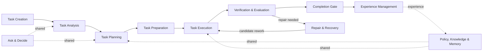

# Architecture Overview

> **Page ID:** `ARCH` · **Type:** Guide / working page · **Phase:** Design now  
> **Status:** Not Started — scaffold; proposed role assignment only.

| Responsibility | Role |
|---|---|
| Owner | Technical Lead / Software Architect |
| Contributors | Backend Engineer (Data & Persistence Owner), Cybersecurity & Backend Engineer (Security Owner), DevOps Engineer (Infrastructure Owner), Frontend Engineer (Frontend Owner), UI/UX Designer & Mobile (Design Owner) |
| Reviewer | AI Engineer & Research Lead |
| Last reviewed / role confirmation | TBD — confirm during team assignment |

> **Objective:** Maintain the single conceptual map of current components and their boundaries; this map defines the displayed lifecycle order.

## How to complete this page

Write in English. Replace prompts with actual findings; keep unresolved questions visible. Use short paragraphs, tables and diagrams only when they improve understanding. Label evidence, assumptions and proposals separately.

## System context

**Required work:** Draw users, Shift Core and external systems; identify trust and responsibility boundaries.

**Expected output / writing format:** Context diagram + actor/responsibility table.

**Working content:** _To be developed by the owner and contributors._

## Component map

**Required work:** Describe runtime layers, shared services and cross-system concerns; show stable IDs and current order without claiming approval.

**Expected output / writing format:** Component ID / name / role / inputs / outputs / status.

**Working content:** _To be developed by the owner and contributors._

## Interactions

**Required work:** Draw control and information flows including non-linear callbacks; explain shared services do not automatically become stages.

**Expected output / writing format:** Diagram + interaction / trigger / exchanged information.

**Working content:** _To be developed by the owner and contributors._

## Design principles

**Required work:** Identify separation of concerns, authority, evidence and experience principles; mark open or agreed.

**Expected output / writing format:** Principle / rationale / source decision.

**Working content:** _To be developed by the owner and contributors._

## Change impact

**Required work:** For each proposed split, merge or move, record affected components and links.

**Expected output / writing format:** Change / dependencies / questions / reviewer.

**Working content:** _To be developed by the owner and contributors._

## Review checklist

- [ ] All required outputs above are present or explicitly marked not applicable with a reason.
- [ ] Claims are supported; proposed material and unknowns are marked.
- [ ] A different person reviews the page, including relevant domain specialists if needed.
- [ ] Links to impacted design, research and decisions are current.

## Related pages

[System Design](DESIGN) · [Shift Core — Home](Home)

## Candidate lifecycle map (editable, not approved)

The diagram is a starting illustration based on the supplied nine-component list; transitions and authority require review. Recovery is conditional, not an inevitable step. Update this map when components move, merge or split.

[Runtime Layers](LAYERS) · [Shared Components](SHARED) · [Cross-System Design](CROSS)
